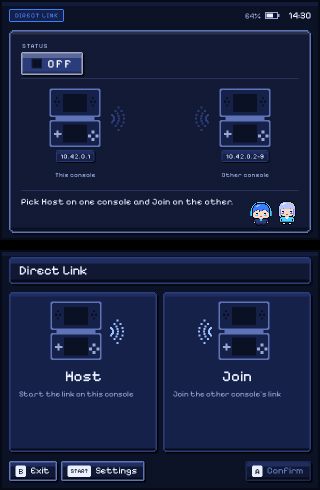
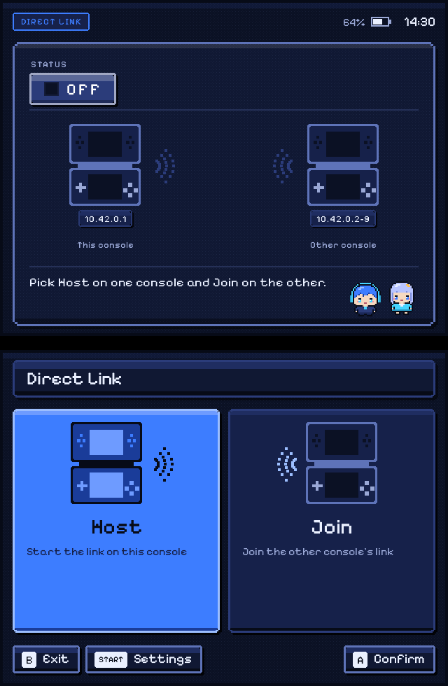
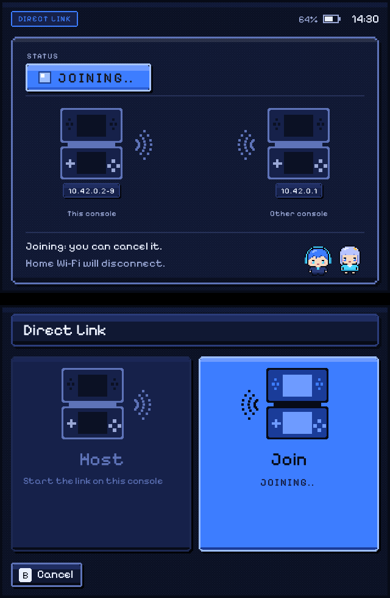
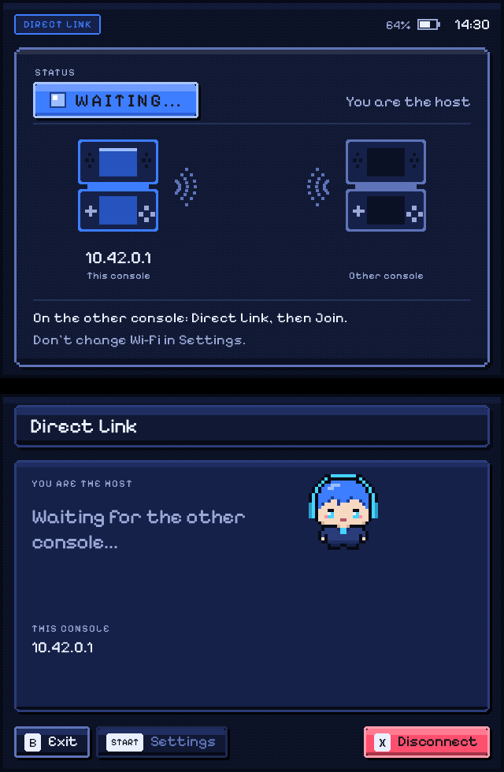
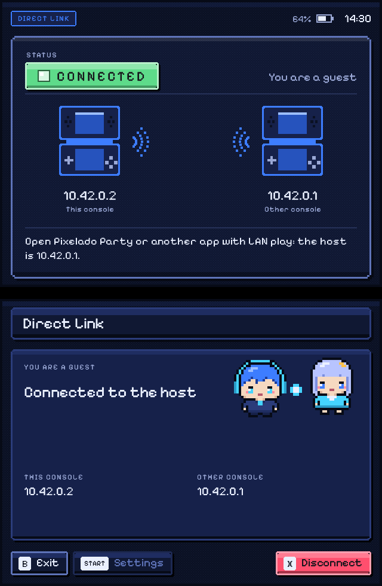

  

<h1 align="center">Direct Link</h1>

  <b>A direct Wi-Fi link between two BananaOS handhelds — no router, fixed addresses, games keep talking.</b>

  <a href="#overview">Overview</a> ·
  <a href="#setup">Setup</a> ·
  <a href="#extras">Extras</a>

<table>
  <tr>
    <td align="center" width="33%">
       
      <b>Host or Join</b> · two big choices
    </td>
    <td align="center" width="33%">
       
      <b>Pick, then confirm</b> · or tap twice
    </td>
    <td align="center" width="33%">
       
      <b>Joining</b> · cancel anytime
    </td>
  </tr>
  <tr>
    <td align="center" width="33%">
       
      <b>Waiting</b> · for the other console
    </td>
    <td align="center" width="33%">
       
      <b>Connected</b> · who is on the link
    </td>
    <td align="center" width="33%">
       
      <b>Guest</b> · connected to the host
    </td>
  </tr>
</table>

## Overview

- 🔗 **Host or join** in two taps — guests use `10.42.0.2`–`10.42.0.9`; the host stays on `10.42.0.1`.
- 👀 **See who is connected** on the top screen, and **cancel** a start or a join while it runs.
- 🎉 Made for **Pixelado Party** and any other app with LAN play.
- 🎮 **Stays up** after you leave the app and while you change games.
- 🏠 **Disconnect** brings back your home Wi-Fi (no internet on the link).
- 🔓 **Open link** on stock BananaOS — no link password in the radio stack.
- 🌐 **English or Spanish** — follows the handheld language.

## Setup

**Option A — one installer file**

1. Download **Install-Direct-Link.sh** from the release.
2. Copy it into **store/tiles** on the shared **banana** folder (do not replace the whole **store** folder).
3. Reboot once, open **Apps**, and run the installer tile.

**Option B — full zip**

1. Download the release zip and extract it.
2. Copy **direct-link** into **store/apps** and **Direct Link.sh** into **store/tiles** (do not replace the whole **store** folder).
3. Reboot once, then open **Apps**.

After either option, leave **Apps** and open **Apps** again so the list refreshes (temporary BananaOS limitation).

Details for the shared **banana** folder are in `INSTALL.txt`.

## Remove it

In the app: **START** (Settings), **Y**, then **A**. Disconnects and removes the app folder and shelf tile.

## Extras

Optional file `/data/banana/direct-link.conf` (read only): `CHANNEL` (`auto` by default: the quietest of 1, 6 and 11; or 1-11), `FREQ`, `SSID`, `BSSID`, `MAX` (seconds; `0` = until you disconnect).

## Built with

Source available under the PolyForm Strict License 1.0.0, with permission to redistribute the unmodified official
releases; see `LICENSE` and `NOTICE`. The screens are C in `core/view.c` on Pixelado's shared pixel renderer,
[pixelado-ui](../pixelado-ui), vendored in `vendor/pixelado-ui/` (its `VERSION` says which commit), so this repo builds on its
own; to work on both at once, run any build script with `PIXELADO_UI_DIR=../pixelado-ui` (for example
`PIXELADO_UI_DIR=../pixelado-ui build/preview.sh`) and sync the copy with `pixelado-ui/tools/vendor.sh .` when it is committed.
The handheld program is `frontends/linux-kms/`, and what BananaOS needs is in `platforms/bananaos/` (`app/wifi-link`
drives the radio). How the screens behave: `docs/UX.md`. The characters (Nilo, Lumi and Pixo here) are pixel maps in
pixelado-ui's `characters/characters.py`. Screenshots: `build/preview.sh`. Package: `build/package.sh`; checks:
`build/selftest.sh`.

## Credits

**Pixelado Dev** — AI-assisted development, tested on hardware when possible. Provided as-is; see `LICENSE`.

## Support

